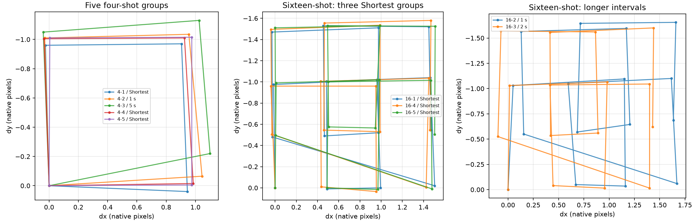

# A7C II Pixel Shift Research

Persistent four- and sixteen-frame pixel-shift capture on **one Sony A7C II
(ILCE-7CM2), firmware 2.01**, with measured RAW displacement, offline merging,
and a checked normal uninstall path.

**Public release: v1.** This names the current, optically adjusted parameter set.
The earlier parameter estimate is development history, not a separate public
release. The private tool/archive names remain unchanged; see the
[version mapping](docs/VERSION_HISTORY.md).

**Status, 14 November 2026:** public v1 remains installed according to the last saved
installation records and the owner's subsequent use. Repeated four-/sixteen-shot
captures work on the research body. The owner reports no currently identifiable
operating problem. This is a one-body research result, not a supported release for
all A7C II cameras.

**Test scope:** physical experiments used only this owner's camera and Windows
PC. The current offline build was checked on that same Windows x64 host; it is
not a claim of compatibility with every computer, driver setup or camera body.
See the concise, de-identified [tested configuration](docs/TESTED_ENVIRONMENT.md).

> **The parameter choice is inferred from one specific camera.** It is not Sony's
> factory pixel-shift calibration and is not established as transferable to another
> body. If you cannot explain a proposed change and its reversal, stop and research
> it, or seek a competent human reviewer or a capable AI agent with evidence and
> offline tools.

**Published starting point:** `C0 = 116`, `C1 = 119`, `C2 = 112` (decimal).
The owner authorizes sharing this final triplet, which is included in the input
example. It produced the reported results on this one body; it is an experimental
starting point for others, not Sony factory calibration or a validated setting
for every A7C II. See [parameters](docs/PARAMETERS.md) and [tuning](docs/TUNING.md).

## What is here

| Area | Included |
| --- | --- |
| Implementation | Offline AP/CP builder, fixed firmware profile, input template, native-helper build/tests and existing review source under `src/v1` |
| Explanation | Native menu, capture sequence, controller-profile/feedback choice, three step coefficients and persistent file changes |
| Results | Sanitized numerical results and plots; failed development approaches are documented too |
| Reversibility | Version transition map, normal undo procedure, and explicit recovery limits |
| Research practice | AI model/effort provenance, refusal reports, narrower research alternatives and contribution guidance |

**This repository is an offline reproduction kit, not a turnkey camera installer.**
It deliberately does not
contain the owner's camera identity, original calibration records, original program files,
modified binaries, service credentials, private generated manifests, RAW photos
or runnable private release bundle. The complete body-bound tools and originals
are retained separately by the owner. See [source scope](src/README.md).

With the exact stock components and explicitly supplied coefficients, a reader
can now reproduce the complete target AP/CP files and inverse without rediscovering
the patch locations. Start with [the build instructions](docs/REPRODUCE.md) and
[input specification](docs/BUILD_INPUTS.md). The example contains the published
starting triplet; the builder requires explicit values and does not connect to
a camera automatically.

## What was achieved

- Native Off/four/sixteen menu choices and native intervals, including Shortest.
- Persistent operation after cold start, without a connected PC for photography.
- Four-shot full-colour sampling and sixteen-shot half-step sampling measured
  from actual RAW image content, rather than assumed from metadata.
- Local four-/sixteen-frame reconstruction; additional sixteen-shot stacks
  reduce noise, with limited further visible detail in the tested desk scene.
- Optically adjusted vertical-step parameters. Across 25 measured quartets, mean
  horizontal/vertical steps were **0.998/1.006 native pixels**. The twelve
  quartets in three Shortest sixteen-shot groups averaged **0.993/1.002 px**.
  These are empirical measurements, not factory tolerances or confidence bounds.



The plotted lines connect measured positions in capture order. Longer intervals
contain image drift and are not evidence that the coefficient itself changed.
The full measurement definition and limitations are in [results](docs/RESULTS.md).

**Later long-series result:** at an owner-reported room temperature of about
**21 °C and 50% RH**, sixteen-shot groups retained the expected sampling pattern.
Shorter intervals generally had smaller positional deviations, including after
a simple drift fit. For a static, ambient-lit scene, **use Shortest as the starting
choice**; these one-body measurements are not a guarantee, and four-shot results
were not uniformly better at shorter intervals. Hotter conditions could change
the behavior substantially or very little; no temperature comparison was made.
Your mileage may vary. See [conditions and detailed results](docs/LONG_SERIES.md)
and [how displacement is measured](docs/MEASUREMENT_METHOD.md). Only numerical
data and plots are included, with no source photos, crops or photo previews.

## Read in this order

1. [How it works](docs/HOW_IT_WORKS.md), [parameter interpretation](docs/PARAMETERS.md), and [how to tune the parameters](docs/TUNING.md).
2. [Development observations](docs/OBSERVATIONS.md), including unsuccessful trials.
3. [Results, consistency and drift](docs/RESULTS.md).
4. [Installation and reversal scope](docs/INSTALL_AND_UNDO.md) and [risks](docs/RISKS.md).
5. [References and upstream changes](docs/REFERENCES.md).
6. [AI-assisted research and refusal reports](docs/AI_RESEARCH.md).
7. [Reproduce the files and helper offline](docs/REPRODUCE.md), with the
   [input specification](docs/BUILD_INPUTS.md) and [tested host scope](docs/TESTED_ENVIRONMENT.md).

To check this public export offline with Python 3.12 or later:

```sh
python tools/check_public.py
```

This checks the export inventory, hashes, Python syntax and local documentation
links. It neither imports the camera tools nor opens USB. Historical device-helper
test results are described separately; this export check is not a hardware test.

## Scope and disclaimer

Unofficial, independent research; no Sony affiliation, approval or warranty.
Only use equipment you own or have explicit permission to modify. Program-file
changes can affect operation and updates. The demonstrated normal undo needs a
working service connection; this project has **not demonstrated recovery from an
unbootable camera or interrupted power during a persistent write**. Successful
readback and offline tests do not provide that guarantee.

Source and documentation are supplied as-is, subject to the [license](LICENSE)
and [third-party notices](NOTICE.md). Firmware, trademarks and third-party
components retain their owners' rights. See the specific [risk explanations](docs/RISKS.md).

No repository or file was uploaded to GitHub when this local export was prepared.
