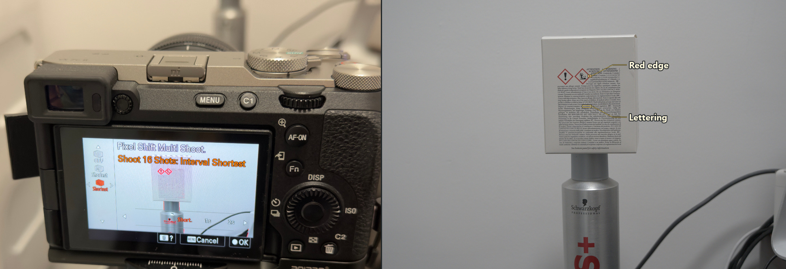
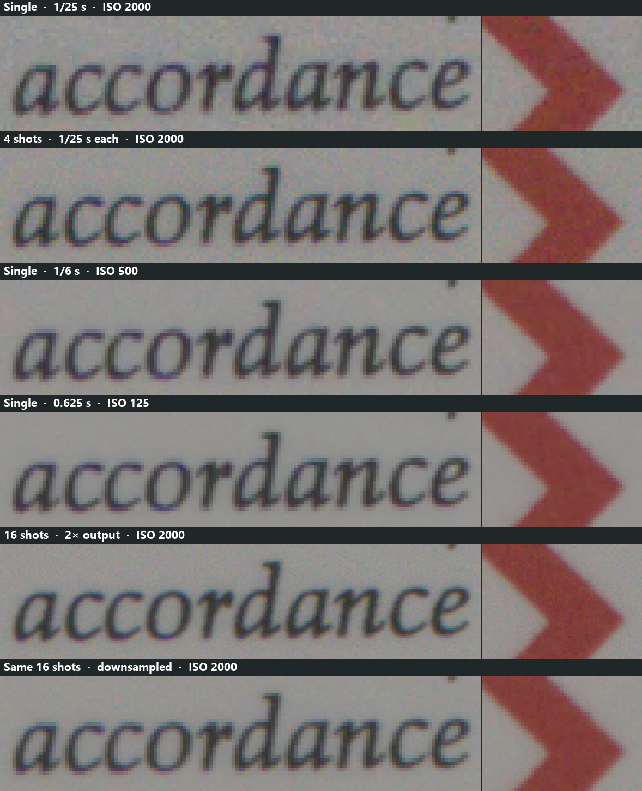

# A7C II Pixel Shift Research

We enabled four-shot and sixteen-shot pixel shift on one **Sony α7C II (ILCE-7CM2) running firmware 2.01**. Both modes remained available after a cold start.

In pixel-shift mode, the camera moves its sensor slightly between exposures. Each RAW frame samples the scene from a different sensor position. Combining the frames on a computer can improve color sampling and reveal fine detail in a still subject.

[](assets/box-label/camera-and-baseline.jpg)

All 23 sample frames were shot with the **Sony FE 28–60mm F4–5.6 at 60 mm and f/8**. The right panel shows the full 7,020 × 4,680 baseline exposure at 1/25 s and ISO 2000. The yellow outlines locate the **147 × 35 pixel lettering crop** and **49 × 35 pixel red-edge crop** enlarged below.

## What does pixel shift change in this photograph?

[](assets/box-label/capture-table.png)

At nearly equal total exposure, the 0.625 s single and the sixteen-frame merge (0.640 s) resolve the same visible strokes in *accordance*. The paper looks smoother in the single exposure.

Compare the last three rows to see the difference at the same magnification. They show the long single, the full sixteen-frame merge, and a copy of that merge downsampled to native resolution. We developed all five captures in RawTherapee. [Wider field of view](assets/box-label/carton-wide.png) · [Results, curves, and processing recipe](docs/REAL_WORLD_RESULTS.md)

**Try the comparison with the same files.** The 1.08 GiB ZIP contains 23 de-identified ARWs and `capture-sequence.json`, which records frame order, timing and file hashes. [Download the sample ZIP from Google Drive](https://drive.google.com/file/d/1zuEARxQN6Az-ZDgjSTrsG0eXrG-QaDJV/view?usp=sharing)

## Research configuration

**Public v1** uses the optically adjusted decimal coefficients **C0 = 116, C1 = 119, C2 = 112**. These are an experimental starting point inferred and measured on one camera. Across 25 measured quartets the mean horizontal/vertical steps were **0.998/1.006 native pixels**. See the [geometry measurements](docs/RESULTS.md), [parameter tuning](docs/TUNING.md) and [version history](docs/VERSION_HISTORY.md).

Physical testing used one owner-operated camera and one Windows PC. For static, ambient-lit subjects, **Shortest** is the starting interval supported by the repeated sixteen-shot measurements. The separate long series was taken at about 21 °C and 50% RH. Results may vary with the setup and environment. [Long-series report](docs/LONG_SERIES.md) · [Tested configuration](docs/TESTED_ENVIRONMENT.md)

Review the proposed change and its reversal before using it on another body. A competent reviewer can work through the evidence and offline tools with you.

## Explore the research

| What do you want to do? | Start here |
| --- | --- |
| Develop the sample photos yourself | [Sample contents](docs/REAL_WORLD_RESULTS.md#sample-raw-files) · [RawTherapee recipe](docs/REAL_WORLD_RESULTS.md#reconstructing-the-images) |
| Understand how the camera moves the sensor | [How pixel shift works](docs/HOW_IT_WORKS.md) · [What the three coefficients control](docs/PARAMETERS.md) |
| Check the accuracy of the shifts | [How displacement is measured](docs/MEASUREMENT_METHOD.md) · [Step and drift results](docs/RESULTS.md) |
| Reproduce the firmware files offline | [Build inputs](docs/BUILD_INPUTS.md) · [Reproduction guide](docs/REPRODUCE.md) · [Source scope](src/README.md) |
| Assess a change on another body | [Tuning guide](docs/TUNING.md) · [Installation and reversal scope](docs/INSTALL_AND_UNDO.md) · [Risks](docs/RISKS.md) |
| Review or contribute evidence | [Development observations](docs/OBSERVATIONS.md) · [References](docs/REFERENCES.md) · [AI research notes](docs/AI_RESEARCH.md) · [Contributing](CONTRIBUTING.md) |

The public firmware tools build and check files offline from the exact stock components and the coefficients you supply. The owner keeps the camera-specific installation sessions and backups privately.

To check this public export offline with Python 3.12 or later:

```sh
python tools/check_public.py
```

This checks the export inventory, hashes, Python syntax and local documentation
links. It neither imports the camera tools nor opens USB. Historical device-helper
test results are described separately; this export check is not a hardware test.

## Scope and disclaimer

Unofficial, independent research; no Sony affiliation, approval or warranty.
Only use equipment you own or have explicit permission to modify. Program-file
changes can affect operation and updates. The demonstrated normal undo needs a
working service connection; this project has **not demonstrated recovery from an
unbootable camera or interrupted power during a persistent write**. Successful
readback and offline tests do not provide that guarantee.

Source and documentation are supplied as-is, subject to the [license](LICENSE)
and [third-party notices](NOTICE.md). Firmware, trademarks and third-party
components retain their owners' rights. See the specific [risk explanations](docs/RISKS.md).
