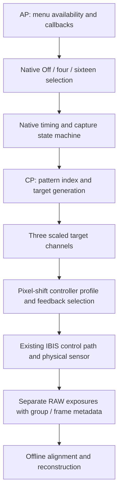

# How the implementation works

The result uses capture machinery already present in the C2 2.01 programs.
Exposing the menu alone was insufficient: early four-frame sequences had valid
group metadata but no intended optical square. The working implementation also
changes the pixel-shift branch's controller configuration and supplies inferred
step values. It does not transplant an A7CR firmware image or its body calibration.



AP is the Linux-side application program (`/usr/lib/appFw.so`); CP is the
companion program (`/cp/cpapp-b.bin`). These names describe this firmware's
components, not an assumption that every Sony model has the same layout.

## The changes

| Component | Purpose | Evidence limit |
| --- | --- | --- |
| AP menu/callback changes | Expose native four/sixteen settings and their normal handlers | A visible menu is not proof of sensor motion |
| CP pixel-shift profile | Select profile 6 in the pixel-shift branch | Other native choices are preserved; globally forcing profile 6 is not the tested change |
| Feedback selection | Use the observed working mode/option pair `(3,1)` together while pixel shift is active | Numeric identifiers are not calibrated actuator gains |
| Three step coefficients | Supply nonzero target scales at five native pattern reads | Inferred and tuned on one body, not factory PXS calibration |
| Persistent writer | Change exact known program ranges and handle stale startup snapshot state | Not a Sony signed update container, bootloader replacement or raw-flash writer |

Simplified functional description:

```text
when native pixel-shift capture is active:
    pattern = native four/sixteen sequencer(frame_index)
    A, B = pattern.target_coordinates
    target = 8192 * [C0 * A, C1 * A, C2 * B]
    use pixel-shift-specific profile 6 and feedback selection (3, 1)
    send target through existing controller path
    let native capture timing save each RAW
otherwise:
    retain the ordinary native branch
```

This is an explanatory model, not compilable replacement firmware. It omits
state transitions, settling, failure handling, coordinate conventions and
native scheduling. The actual bounded changes and write order are reviewed in
the source snapshots and the private generated manifests.

## Persistence and normal undo

The tested writer verifies source identity, complete program hashes and the
expected operating state, then performs bounded offset writes rather than
replacing whole files. It verifies complete readbacks, synchronizes writes and
handles the startup snapshot separately. A battery power cycle loads the new
programs, and a new-boot verification checks the installed state.

The current public v1 program state differs from the preserved stock references
by 134 bytes: 46 in AP and 88 in CP. During development, the initial installation
transferred 206 bytes in 36 windows. The later coefficient correction wrote
three complete four-byte CP instruction windows, 12 bytes total, while leaving
AP unchanged. These are historical operations, not a newly combined public
installer. See [version mapping](VERSION_HISTORY.md) for the private tool names.
Small writes reduce the edited surface, but a few instruction bytes can still
be critical; write length alone does not establish safety.

The writer is adapted from the MIT-pinned upstream offset-writer example.
It uses the existing native helper staging route, not the separate preload-file
execution route described in the newer reference documentation. Neither the
upstream reference nor this source export is an instruction to run a generic
shell or arbitrary payload on the camera.

Selected stored calibration records are compared before/after and preserved.
The evidence establishes equality for those observed records, not a complete
audit of every possible persistent location in the camera.

The [tuning guide](TUNING.md) explains how to derive a small coefficient correction
from repeated measurements and what must be rebuilt in a private update package.
