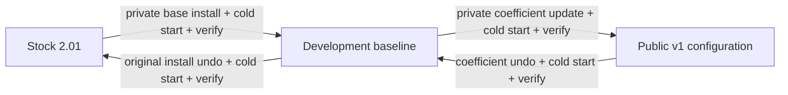

# Installation and reversal scope

The public source is a review export, not an installer for an arbitrary body.
The owner retains the complete private development installer and coefficient-update
bundles, original files, calibration snapshots, compiled helpers and the exact
installation sessions. Their historical filenames are mapped in
[VERSION_HISTORY.md](VERSION_HISTORY.md); the private runbook contains the
current-PC commands. Public v1 names the final configuration, not a new combined
stock installer.

The public [offline build workflow](REPRODUCE.md) can reproduce the complete
desired program files and compile the full-transition helper using explicit local
inputs. Those generated artifacts are not body-bound or approved for deployment;
they must not be substituted into the preserved CP-only private updater.

**The coefficient-update undo does not restore stock.** Do not send the original
base-install undo directly to the current CP image, bypass its hash checks, or substitute another project's
factory-restore function. No coexistence with the updated upstream tools is
claimed.

## Existing private workflow

1. Offline package check and session setup; the exact camera/model/version and
   original/candidate hashes are bound to the private package.
2. Owner connects a powered, idle camera, PXS Off, using Image Transfer (MSC).
3. `prepare` reads/checks complete programs and selected body records and runs
   the fixed check helper. Helper staging is an action even though this stage
   does not install the persistent patch.
4. `install` performs the reviewed writes and snapshot finalization. Maintain
   power/USB until completion; select MSC at the stated normal-return prompt.
5. Unplug while On after successful completion, switch Off, wait for shutdown,
   remove the battery for at least a minute, reinsert and start.
6. Reconnect in MSC and `verify --confirm-power-cycle`; ordinary capture follows
   after unplugging. No PC is needed during everyday PXS use.

Undo uses the **same saved session that owns the installation**, followed by its
own cold start and verification. Reinstallation after a completed stock restore
uses new sessions. Do not reuse an installed/restored journal as if it were new.

This sequence describes the tested tools. It is not permission to connect a
camera automatically from an AI agent or to transplant this body's parameters.

## If anything stops

Retain the logs and distinguish an operation that never wrote, a known partial
write, a completed write awaiting cold start, and an unknown state. A normal
mode-selection prompt during service exit is expected; an error elsewhere needs
the actual report. Do not repeatedly issue install or power-cycle an in-progress
persistent write just to see whether it works.

Normal reversal has physical evidence for the initial development installation.
The later coefficient-update inverse is checked by offline tests but has not
been physically demonstrated in the retained session.
Neither supplies a separately bootable emergency recovery environment. See
[why these distinctions matter](RISKS.md).
