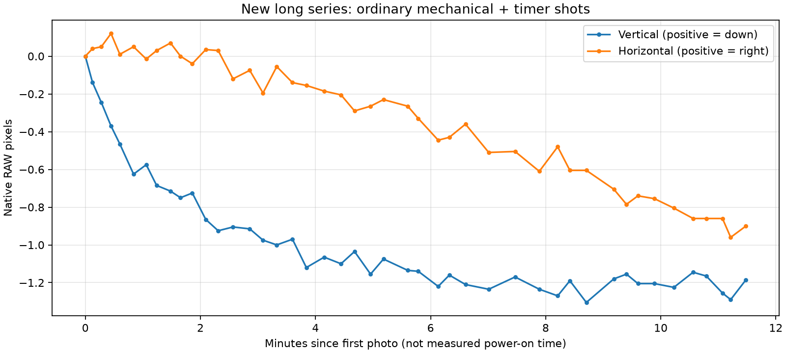
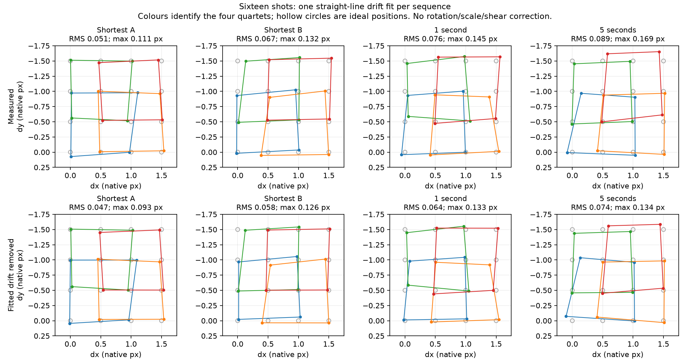

# Long series: operating conditions, interval comparison and drift fitting

This is a further observation of the same research body with persistent public v1,
not independent validation on another camera. The public record includes
[numerical measurements](../evidence/long-series.json) and plots only. Source
RAWs, HIFs, crops and photo previews remain private.

## Conditions

| Item | Recorded condition / source |
| --- | --- |
| Camera | One ILCE-7CM2, firmware 2.01, current public v1 configuration |
| Environment | **About 21 °C room temperature and approximately 50% relative humidity**, reported by the owner |
| Starting state | Owner described it as roughly cold: power On, set up the view, Off for a few minutes, then On and begin |
| Camera temperature | Not measured; the later assumption that it was warmed up was not independently verified |
| Ordinary shots | Mechanical shutter with timer; **SteadyShot On**, confirmed by owner; timer duration not specified |
| Pixel shift | Native four-/sixteen-shot sequence using its separate controller path; the ordinary SteadyShot setting is not an SS-Off control for the whole run |
| Exposure | Metadata: 60 mm, f/5.6, 1/40 s, ISO 2000 throughout |
| Focus and handling | **Fixed/manual focus throughout**, confirmed by owner; no quantified handling record |
| Time origin | First recorded exposure, not the exact power-on time |

There were 45 ordinary shots over 688.822 seconds, then four four-shot groups
and four sixteen-shot groups, followed by two ordinary shots. The total recorded
span was 939.753 seconds. Native group/frame tags identify complete PXS groups;
capture timestamps establish the actual intervals.

The temperature and RH are context, not an operating specification. **A hotter
environment might change the magnitude or time course substantially, or might
make little difference. These measurements do not establish which.** There was
no controlled temperature/RH comparison, camera-temperature log or proof of
thermal equilibrium. Do not turn the observed 6–8-minute plateau into a universal
warm-up time or assume these coefficients have been qualified across climates.

## Ordinary-shot drift

The image moves about 0.73 native pixel upward in the first two minutes and is
roughly 1.2 pixels upward by six minutes. From six to 11.5 minutes the overall
vertical trend is nearly flat, with about 0.16 pixel peak-to-peak variation.
Horizontal movement continues, reaching about 0.90 pixel leftward before PXS.
Over approximately 8–11.5 minutes, fitted rates are +0.007 dy / -0.119 dx pixels
per minute (positive dy is down; positive dx is right).

The two final ordinary images remain approximately 1.26/1.38 pixels up and
1.18/1.20 pixels left of the first image. Turning PXS Off does not return the
framing to its initial position in this run.

These are SS-On image coordinates. They may combine support/lens/body movement,
sensor holding, stabilization state and registration effects. Even if ordinary
stabilization corrected only during an exposure, that could affect the position
recorded in the photo. This run does not isolate thermal drift or establish the
exact activation timing of stabilization. Earlier SS-Off observations remain
separate evidence that SS On is not necessary for all observed drift.

## Pixel-shift geometry

| Group, capture order | Mean measured interval | Mean H / V step, native pixels |
| --- | --- | --- |
| Four-shot Shortest A | 0.500 s | 1.020 / 0.973 |
| Four-shot Shortest B | 0.512 s | 1.048 / 1.025 |
| Four-shot 2 s | 2.002 s | 1.013 / 0.998 |
| Four-shot 10 s | 9.965 s | 0.990 / 1.008 |
| Sixteen-shot Shortest A | 0.503 s | 1.003 / 0.980 |
| Sixteen-shot Shortest B | 0.503 s | 0.994 / 0.997 |
| Sixteen-shot 1 s | 1.007 s | 0.996 / 0.989 |
| Sixteen-shot 5 s | 5.001 s | 0.984 / 1.001 |

Across 20 quartets, the mean is 0.999 H / 0.993 V pixels, with quartet SD about
0.034 / 0.033 pixels. This average does not describe every corner or frame.
The final sixteen-shot group spans 75.009 seconds; its start-to-end residual
after nominal-pattern subtraction is about 0.136 pixel in magnitude. That
residual mixes geometry and movement; it is not pure measured thermal drift.

## Sixteen-shot deviations, including a drift fit

The comparison below removes the common framing offset. The second model also
fits one constant velocity against actual capture times. No per-frame free
correction is used to force the points onto the ideal grid.

| Sixteen-shot group | Before fit RMS | Before fit worst point | After linear-drift fit RMS | After fit worst point |
| --- | --- | --- | --- | --- |
| Shortest A | 0.051 px | 0.111 px | 0.047 px | 0.093 px |
| Shortest B | 0.067 px | 0.132 px | 0.058 px | 0.126 px |
| 1 s | 0.076 px | 0.145 px | 0.064 px | 0.133 px |
| 5 s | 0.089 px | 0.169 px | 0.074 px | 0.134 px |

All errors are Euclidean distances in native pixels, not doubled-output pixels.
The simple fit explains about 17–31% of squared deviation. Additionally allowing
a shared affine grid gives RMS 0.045/0.052/0.062/0.071 pixels respectively, so
neither one global grid distortion nor smooth drift accounts for everything.
The pattern remains recognizable; the residuals include registration error and
are not established as random physical actuator error. This is a geometric fit
to existing measurements, not a new merged-image quality comparison.

The earlier `test_coef_1` sixteen-shot groups also favor Shortest: their worst
centered ideal-pattern deviations were 0.038–0.068 pixel, versus 0.164 at 1 s and
0.086 at 2 s. This is supporting evidence from another setup, not a pooled
controlled interval experiment.

**Four-shot results are not monotonic.** Here the 2-second group is closer to
the ideal grid than either Shortest group. The 10-second square is about 5°
rotated, but has the smallest shape residual after allowing rotation and one
uniform scale. Grid alignment and square regularity are different properties.

## Recommendation and limits

**For a static, ambient-lit scene, use Shortest as the default starting choice.**
It limits elapsed time for movement, and the sixteen-shot observations here and
in the earlier comparison generally favor it. Use a longer interval when needed
for a specific capture constraint such as flash recycle or demonstrated settling;
this recommendation does not establish that every slower group is worse.
**Your mileage may vary.**

The interval groups were few and acquired in chronological order, with time,
handling and operating state not independently controlled. The median CFA/RGB
displacement disagreement is about 0.011 pixel, but agreement between methods
does not exclude shared bias. Within PXS groups, the typical largest regional
departure from the frame median is about 0.09 pixel per axis; the 90th-percentile
departure is about 0.17 dy / 0.21 dx. Those are descriptive spreads, not confidence
intervals. Fine differences should not be used as precise coefficient corrections.

A fit on the same observations is not independent proof of its causal model.
Measured per-frame alignment can help reconstruction; it cannot undo intraframe
blur, arbitrary scene motion or uncertainty in the measurements themselves.
See [the measurement method](MEASUREMENT_METHOD.md) for what was actually calculated.
