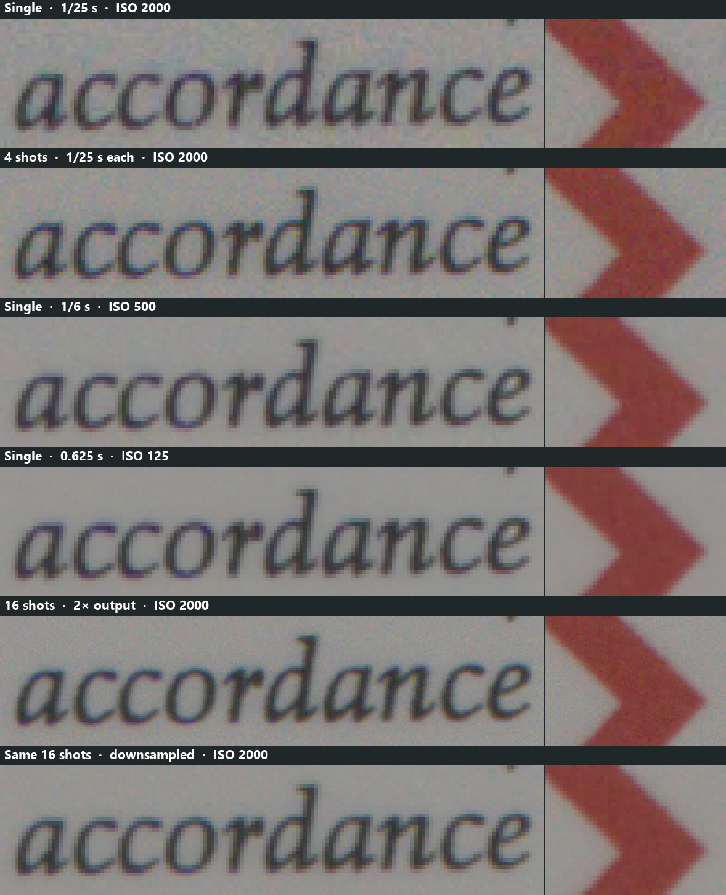
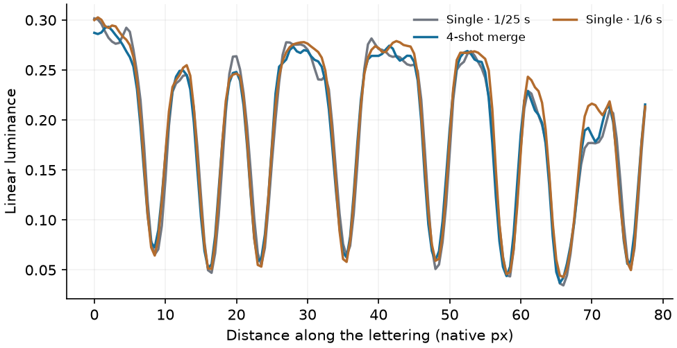
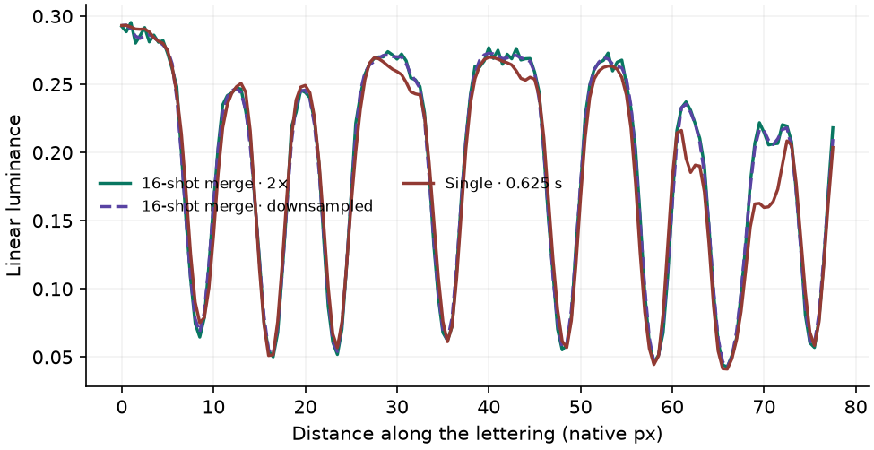
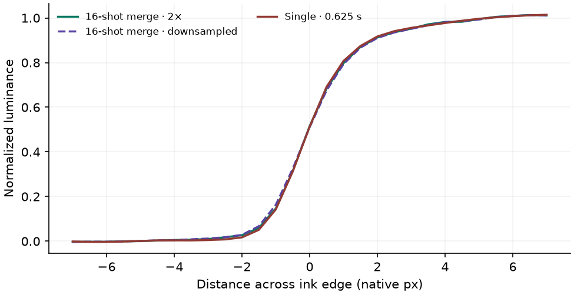
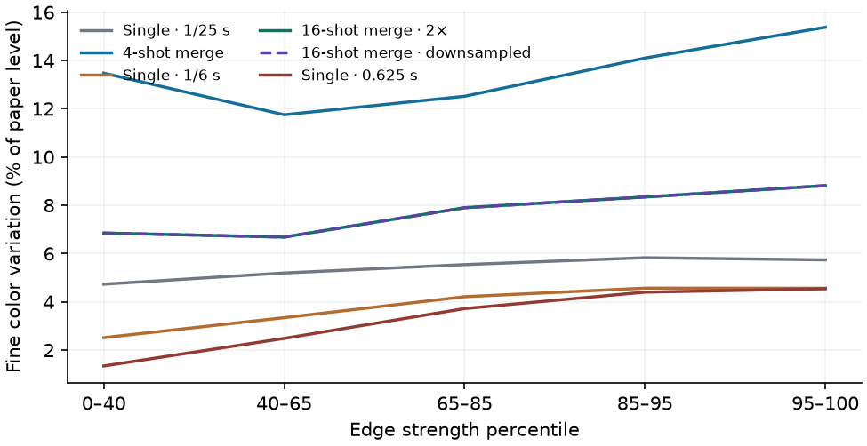
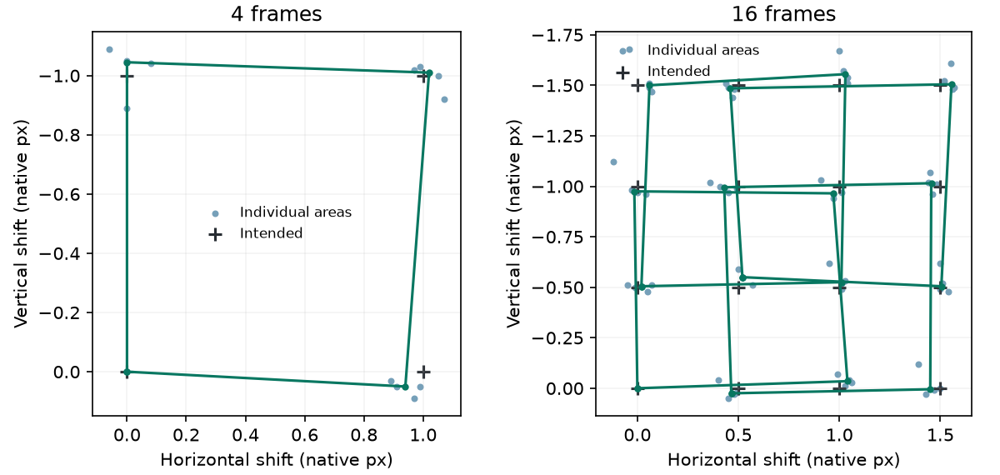

# Pixel shift on carton fine print

The 0.625 s single exposure and the sixteen-shot merge resolve the same visible strokes in *accordance*. Their total shutter-open times differ by only 0.015 s. The paper looks smoother in the single exposure.

[](../assets/box-label/capture-table.png)

Read down one letter stroke to compare its outline, the color fringe, and the grain of the paper beside it. The word *accordance* appears on the left and the edge of the red diamond on the right. The last three rows show the long single, the full sixteen-shot merge, and its downsampled copy.

All six rows use the same magnification. At full PNG size, one native sensor pixel spans six display pixels. One pixel of the 2× reconstruction spans three. Nearest-neighbor enlargement keeps the individual samples visible.

For more of the scene, the [wider comparison PNG (3,114 × 2,686)](../assets/box-label/carton-wide.png) shows the same 778 × 435 native-pixel area from all six renders. Open it at full size to inspect other letters.

## Capture and output sizes

One Sony α7C II and FE 28–60mm F4–5.6 lens captured the scene at 60 mm and f/8. The pixel-shift frames were each exposed for 1/25 s at ISO 2000. The mean intervals between exposure timestamps were 0.478 s in the four-frame set and 0.499 s in the sixteen-frame set. Shutter-open totals exclude those gaps.

| Capture | Total shutter-open time | ISO | Output dimensions | Fine luminance variation on paper |
| --- | ---: | ---: | ---: | ---: |
| Baseline single | 0.040 s | 2000 | 7,020 × 4,680 | 3.99% |
| Four-shot merge | 0.160 s | 2000 | 7,032 × 4,680 | 3.56% |
| 1/6 s single | 0.167 s | 500 | 7,020 × 4,680 | 2.01% |
| Sixteen-shot merge, 2× sampling | 0.640 s | 2000 | **14,072 × 9,368** | 1.80% |
| Same sixteen-shot merge, downsampled | Same capture | 2000 | **7,036 × 4,684** | 1.80% |
| 0.625 s single | 0.625 s | 125 | 7,020 × 4,680 | 1.05% |

The two sixteen-shot images come from one reconstruction. Each pixel in the smaller file averages four adjacent samples in linear light. The table enlarges the smaller view to match the others. To inspect the same crop at each file’s own sampling, open the [612 × 272 double-grid crop](../assets/box-label/sixteen-2x-detail.png) and the [306 × 136 downsampled crop](../assets/box-label/sixteen-native-detail.png). The small differences in full-frame borders come from decoding the ARW and ARQ inputs.

## Detail, paper, and color

| Letter strokes in the four-shot comparison | Letter strokes in the sixteen-shot comparison |
| --- | --- |
|  |  |

Dark troughs mark the strokes crossed by the same line through *accordance*. The downsampled result retains the visible stroke separations on this line. At the outer edge of the red diamond, the measured 10–90% transition spans **3.12 native pixels** for the full sixteen-shot output, **3.21** after downsampling and **3.03** for the longest single. Adjacent paper texture, the printed boundary, lens and interpolation all influence these widths.



The longest single exposure shows less fine color variation along the strongest lettering edges. Median variation there was **4.54%** of paper brightness for the single, **8.82%** for the sixteen-shot merge, and **8.81%** for its downsampled copy. Both sixteen-shot measurements use the same native-resolution grid.



**Lens chromatic aberration can produce colored fringes around the black ink.** We used the same lens and aperture throughout and disabled automatic chromatic aberration correction. The measured variation includes the effects of the lens, ink, sensor sampling, demosaicing, and merge. How much came from the lens alone remains uncertain.

## Where the frames landed



For this plot, four 384 × 384 regions of carton detail were matched against frame 1 in the original RAW green samples. Crosses show the intended positions, dots the local measurements, and the connected points the median shift. The measured RMS departures from the intended positions were **0.046** and **0.046 native pixels** respectively. The plot was calculated independently of the render. The reconstruction below uses the Sony sequence’s prescribed sampling positions.

## Sample RAW files

**[Download the box-label sample ZIP from Google Drive (1.08 GiB)](https://drive.google.com/file/d/1zuEARxQN6Az-ZDgjSTrsG0eXrG-QaDJV/view?usp=sharing)**. Extract it into one folder. It contains the three single exposures, both complete pixel-shift groups and the JSON manifest. The filenames below match the reconstruction recipe.

| Files | What they contain |
| --- | --- |
| `baseline.ARW`, `single-medium.ARW`, `single-long.ARW` | Single exposures at 1/25 s, 1/6 s and 0.625 s respectively |
| `four-01.ARW` through `four-04.ARW` | Four-shot sequence in capture order |
| `sixteen-01.ARW` through `sixteen-16.ARW` | Sixteen-shot sequence in capture order |
| `capture-sequence.json` | Per-frame settings, elapsed time in milliseconds, measured intervals and SHA-256 hashes. [View the manifest](../evidence/box-label-sequence.json) |

These uncompressed Sony-compatible sharing copies preserve the visible Bayer samples, white balance, model, lens, aperture, focal length, ISO, shutter speed and pixel-shift order. Capture dates were rebased to a synthetic start time and group IDs reassigned. Relative timing is intact. Each file was rebuilt with selected metadata to remove ownership, serial numbers, location information and embedded previews. All 23 visible Bayer arrays matched their originals, and ExifTool read both complete groups in order.

To verify the downloaded archive, compare its SHA-256 with `aa44dcb1db85aea2e5a8c061d80352a0351201f3975c6e3e167a39099a20834d`.

## Reconstructing the images

1. Pack each complete Sony sequence into a pseudo-ARQ using **make_arq**. This modified camera identifies itself as ILCE-7CM2, a model missing from the upstream list. The supplied compatibility patch adds that model. For the metadata-clean samples it also reads the shot number and white balance from the retained tags. The original Sony phase packing code is unchanged. [Upstream source used](https://github.com/agriggio/make_arq/tree/912069a8e6d3c6738cd76ba0fe6c62ed4d314fe3) · [Compatibility patch](../examples/box-label/make-arq-c2.patch)
2. Develop the three ARWs with AMaZE and the two ARQs with RawTherapee’s Pixel Shift method. Both use camera white balance, the camera matrix, +1 EV, no added sharpening or denoising, and 16-bit sRGB output. Pixel-shift motion correction was disabled for this static comparison. The same exposure compensation applies to every render. [RawTherapee 5.13](https://github.com/RawTherapee/RawTherapee/releases/tag/5.13) · [Common profile](../examples/box-label/common.pp3) · [Single](../examples/box-label/single.pp3) · [Pixel shift](../examples/box-label/shift.pp3)
3. For the native-size sixteen-shot version, decode the output ICC tone curve, take a 2 × 2 arithmetic mean in linear RGB, and reapply the output tone curve. The inspection PNGs repeat the rendered pixels at integer magnification. The numerical lettering and edge profiles use cubic enlargement in linear light for the native-size views and original samples for the double-grid view. Whole-image translation was measured only to place the display crops on the same lettering and symbol.

For example, from a checkout of make_arq at the linked revision, with its documented dependencies installed and ExifTool on PATH, apply the patch and run the following PowerShell commands. Set the three paths to your local sample folder, this repository, and the RawTherapee CLI executable.

```powershell
git apply -- "$Repo/examples/box-label/make-arq-c2.patch"
$Four = @(Get-ChildItem -LiteralPath $Samples -Filter 'four-*.ARW' | Sort-Object Name | ForEach-Object FullName)
$Sixteen = @(Get-ChildItem -LiteralPath $Samples -Filter 'sixteen-*.ARW' | Sort-Object Name | ForEach-Object FullName)
python make_arq.py -o four.ARQ @Four
python make_arq.py -o sixteen.ARQ @Sixteen
& $RT -q -o four.tif -p "$Repo/examples/box-label/common.pp3" -p "$Repo/examples/box-label/shift.pp3" -t -b16 -c four.ARQ
& $RT -q -o sixteen.tif -p "$Repo/examples/box-label/common.pp3" -p "$Repo/examples/box-label/shift.pp3" -t -b16 -c sixteen.ARQ
& $RT -q -o long.tif -p "$Repo/examples/box-label/common.pp3" -p "$Repo/examples/box-label/single.pp3" -t -b16 -c "$Samples/single-long.ARW"
```

The example files have descriptive filenames. The reported measurements used the original captures. The sharing copies preserve the visible Bayer data and omit inactive row padding, so their decoded file borders can differ slightly.

## Measurement details

The lettering trace averages seven display rows at matched magnification. The diamond profile averages 74 display rows crossing the slanted outer edge, bins samples at 0.5-native-pixel intervals, and normalizes to the local ink and paper plateaus. These are natural-edge measurements on this print.

We measured fine luminance variation in a 480 × 240 native-pixel patch of blank paper. We subtracted a Gaussian blur (σ = 2 native pixels), multiplied the median absolute deviation of the residual by 1.4826, and divided by median paper luminance. The result includes paper texture and image noise.

For the color curves, we measured fine variation in the red–green and blue–green channel differences in linear sRGB. We used the longest single exposure to define the edge-strength bins and the reference paper level for all renders. Both analyses used the 16-bit renders. [Numerical profiles and raw displacement measurements](../evidence/box-label-results.json)
