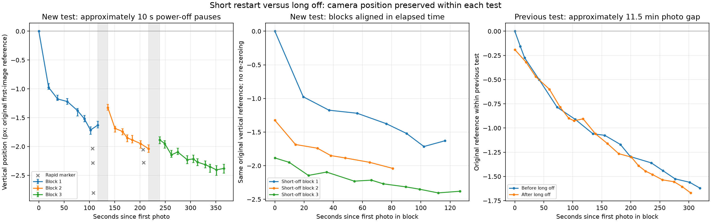

# Results and measurement limits

Positions are estimated from RAW image content. Sony group/frame metadata helps
identify capture order; it is not a sensor-position measurement used here.

The existing measurement code decodes RAWs, estimates coarse movement without
imposing a one-pixel bound, then compares multiple textured regions using green
CFA planes and linear demosaiced green. Bandpass filtering and subpixel phase
correlation are cross-checked at two scales. The numerical reporting grid is
not a calibrated accuracy claim.

The full [measurement-method description](MEASUREMENT_METHOD.md) explains the
reference frames, coarse/fine registration, sign conventions, regional checks,
grid fits and drift fits. Image displacement is not direct actuator telemetry.

## Step geometry

| Study | Samples | Horizontal / vertical mean step |
| --- | --- | --- |
| Initial development estimate, repeated desk study | 13 quartets | 0.982 / 0.915 px |
| Public v1, first repeated capture | 25 quartets: five four-shot and five sixteen-shot groups | 0.998 / 1.006 px |
| Public v1, Shortest sixteen subset | 12 quartets in three sixteen-shot groups | 0.993 / 1.002 px |

The initial/current scenes and poses differed; this is not a simultaneously matched
before/after calibration experiment. The current full-set quartet SD was about
0.043 H / 0.018 V pixels, versus 0.018 / 0.014 for the Shortest subset.
Median CFA/RGB displacement disagreement was approximately 0.007 px.

The [sanitized measurements](../evidence/measurement-summary.json) retain group
positions and step fits without source RAWs, camera identifiers or calibration.

In the earlier repeated sixteen-shot study, corresponding positions had roughly
0.026–0.035 px RMS deviation from the three-run mean; removing each quartet's
translation reduced shape RMS to roughly 0.014–0.022 px. The first quartet was
not uniquely bad. Spatial regions and processing methods are correlated, so
these spreads are not 95% confidence intervals or independent replication.

## Merging and image quality

Four-shot reconstruction corrects measured fractional offsets within each CFA
colour plane before the intended integer-phase merge. Sixteen-shot processing
combines four half-step quartets on a doubled grid; native-size comparisons use
a 2×2 average in linear RGB. Additional sixteen-shot outputs are aligned and
averaged for multi-set stacks.

The owner saw sharper text in four-shot output than a single longer exposure,
with more visible grain, and good colour in both four- and sixteen-shot output.
Two-/three-set sixteen stacks reduced shadow noise with little extra apparent
detail in the tested desk scene. These observations should not be replaced by
a blanket conclusion that the feature does not work. Nor do they establish
universal superiority: total exposure, ISO, demosaic, interpolation, sharpening,
lighting and movement affect the comparison.

Measured between-frame translation can be corrected in reconstruction. It cannot
undo blur within one exposure or arbitrary subject motion. A common 0.25-pixel
offset of a whole set merely changes framing; a changing offset needs alignment.
Fractional interpolation itself can reduce the finest detail.

## Drift and restart observations

Remote ordinary electronic shots with SteadyShot Off moved about 0.705 native
pixel vertically over 122.652 seconds. A rapid trio at 0.535/0.637-second gaps
did not show the same fixed upward step per capture. This weakened a simple
per-shutter-step explanation without identifying the physical cause.

Short power-off periods were user-reported as about ten seconds; the measured
photo-to-photo gaps were about 20/22 seconds, including startup and timer. The
earlier long gap was about 11.5 minutes between photos, not a precisely logged
power-off duration. Returns were 0.305/0.155 pixels after short pauses, versus
1.430 pixels after the long gap using the last delayed pre-marker reference.

The result favors an off-duration-dependent contribution over a complete instant
reset. Temperature, lens/support relaxation, internal sensor holding and handling
were not independently measured. Pixel Shift Off is still modified firmware;
a matched actual-stock comparison would be needed to assign any extra drift to
this modification.

Published thermal camera drift establishes physical plausibility, not a normal
A7C II drift-rate limit. See [references](REFERENCES.md). For a static ambient-lit
subject, Shortest limits the time available for drift. Longer intervals may be
needed for flash recycle or observed settling. Neither recommendation guarantees
motion-free captures.

## Later long series at approximately 21 °C / 50% RH

The [long-series report](LONG_SERIES.md) adds 127 RAW measurements: 45 ordinary
stills over 11.5 minutes, four four-shot groups, four sixteen-shot groups, and
two final ordinary stills. Ordinary shots used mechanical shutter, a timer and
**SteadyShot On**; this is not an SS-Off baseline. Focus was **fixed/manual
throughout**, confirmed by the owner. All shots were 60 mm, f/5.6,
1/40 s and ISO 2000. Room temperature/humidity are approximate owner reports,
not measured camera temperatures or a controlled environmental experiment.

During the ordinary portion, vertical drift mostly levels off around 6–8 minutes
while horizontal drift continues. The later PXS quartets average about 0.999 H /
0.993 V native pixels. Sixteen-shot positional RMS after a single linear drift
fit is 0.047/0.058 px for the two Shortest groups, 0.064 px at 1 s and 0.074 px
at 5 s. Regional measurement spread remains appreciable; the fit is descriptive.

Together with the earlier interval comparison, this supports **Shortest as a
practical default for this use**, not a universal optimum. Four-shot results
provide exceptions. Hotter/cooler conditions, equipment and handling may produce
different behavior; neither the amount nor direction of any environmental effect
is established. Your mileage may vary. The report and
[sanitized numerical data](../evidence/long-series.json) contain no photographs.
